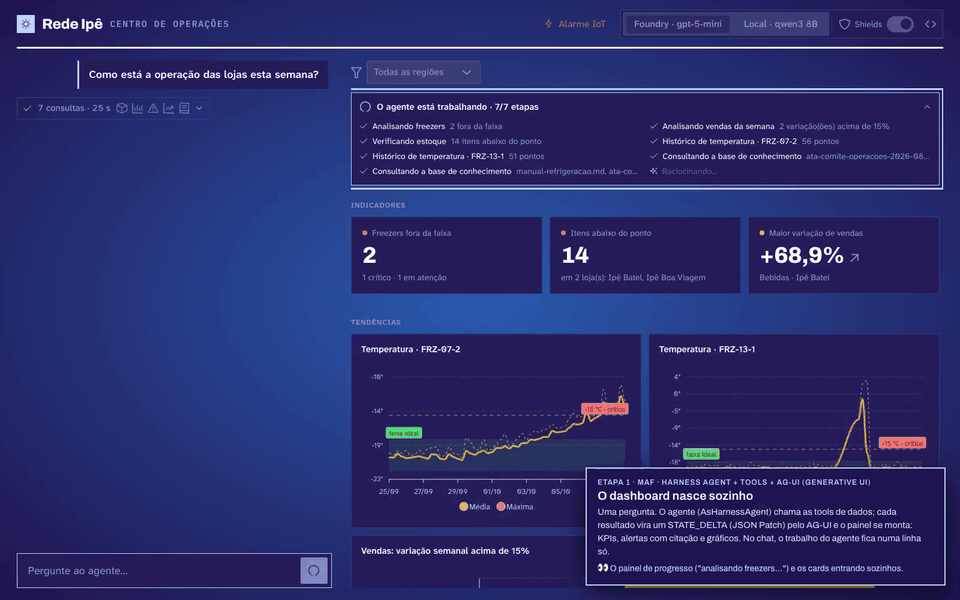

# Master Class Microsoft Agent Framework

**Do zero ao agente em produção.** O material e o código da Master Class de Microsoft Agent Framework (MAF) em C#, da AzureBrasil Cloud.

- **Slides:** https://carlosmachel.github.io/masterclass-maf/
- **Guia com a lógica e o código de cada cena:** https://carlosmachel.github.io/masterclass-maf/guia.html

A demo é o Centro de Operações da **Rede Ipê**, uma rede fictícia de 20 supermercados com três problemas escondidos nos dados. Um agente monta o painel sozinho, explica o porquê com citação, respeita os filtros da tela, pede aprovação antes de agir, resiste a um documento envenenado, acorda com um alarme, conversa com outro agente por A2A, tem teste e atende o Claude Code por MCP.



## As cenas

| Cena | O que acontece | Tópico técnico | GIF |
| --- | --- | --- | --- |
| 0 | 20 lojas, 3 problemas escondidos | [A arquitetura da demo](docs/topicos/00-arquitetura.md) | [ver](gifs/cena-0.gif) |
| 1 | Uma pergunta, o painel se monta | [Criar um agente Harness](docs/topicos/01-agente-harness.md) | [ver](gifs/cena-1.gif) |
| 2 | O dado diz o quê, o documento diz por quê | [RAG com Foundry IQ como tool](docs/topicos/02-rag-foundry-iq.md) | [ver](gifs/cena-2.gif) |
| 3 | Ninguém digita, o agente reanalisa | [Estado compartilhado com AG-UI](docs/topicos/03-estado-compartilhado.md) | [ver](gifs/cena-3.gif) |
| 4 | O agente pede, você decide | [Aprovação humana de tools](docs/topicos/04-aprovacao-humana.md) | [ver](gifs/cena-4.gif) |
| 5 | Um documento envenenado na base | [Middleware contra prompt injection](docs/topicos/05-prompt-injection.md) | [ver](gifs/cena-5.gif) |
| 6 | O agente acorda sozinho | [Workflows e A2A](docs/topicos/06-workflows-a2a.md) | [ver](gifs/cena-6.gif) |
| 7 | Agente também tem teste | [Eval de agente](docs/topicos/07-eval.md) | [ver](gifs/cena-7.gif) |
| 7b | O mesmo agente, outro canal | [Agente como servidor MCP](docs/topicos/07b-mcp.md) | [ver](gifs/cena-7b.gif) |

O resumo de features e código-chave de cada cena está em [`docs/cenas.md`](docs/cenas.md).

## Stack

.NET 10 · Microsoft Agent Framework 1.24 (Harness, AG-UI, A2A, Workflows) · Aspire · Vue 3 + PrimeVue com um cliente AG-UI escrito à mão · Azure OpenAI (`gpt-5-mini`) no Microsoft Foundry · Foundry IQ (Azure AI Search) · Azure AI Content Safety (Prompt Shields) · Azure SQL com EF Core · Ollama (`qwen3:8b`, opcional) · Microsoft.Extensions.AI.Evaluation · MCP C# SDK.

O código está em inglês. Tudo o que a plateia vê (a tela, os prompts, as descrições das tools, os dados e os documentos) está em português.

## Rodar

Precisa de .NET 10, Node 22 e um recurso do Azure OpenAI com um deployment de chat. Tudo autentica com `DefaultAzureCredential` (`az login`), sem chaves.

```bash
az login
dotnet user-secrets --project src/Ipe.Agent set AzureOpenAI:Endpoint https://<recurso>.openai.azure.com/
dotnet user-secrets --project src/Ipe.Agent set AzureOpenAI:Deployment <deployment>
dotnet user-secrets --project src/Ipe.Agent set Demo:Mode Local    # dados de data/csv e data/docs, sem SQL nem Foundry IQ
(cd web && npm ci)
dotnet run --project src/Ipe.AppHost      # agente + agente do CD (A2A) + tela + painel do Aspire
#   tela:    http://localhost:4280
#   aspire:  http://localhost:15000
```

Para o modo completo no Azure (`Demo:Mode` = `Azure`), crie o Azure SQL e o Foundry IQ seguindo [`data/README.md`](data/README.md) e configure `ConnectionStrings:Ipe` e `FoundryIQ:Endpoint` com `dotnet user-secrets`. O Prompt Shields usa o mesmo recurso de IA do modelo.

Modelo local (opcional, para o seletor de modelo da tela):

```bash
ollama pull qwen3:8b && ollama create qwen3-ipe-8b -f ollama/Modelfile
```

## Projetos

| Projeto | O que é |
| --- | --- |
| `src/Ipe.Agent` | O analista (Harness + tools), o workflow do plantão e os endpoints AG-UI e MCP |
| `src/Ipe.DistributionCenter` | O agente do CD, outro processo, exposto por A2A |
| `src/Ipe.AppHost` · `src/Ipe.ServiceDefaults` | Orquestração com Aspire e OpenTelemetry |
| `src/Ipe.Agent.Tests` | Testes de unidade e de dados (modo Local) |
| `src/Ipe.Agent.Evals` | Evals com Microsoft.Extensions.AI.Evaluation |
| `src/Ipe.FoundryIQ.Setup` | Cria a knowledge base do Foundry IQ |
| `src/Ipe.Smoke` | Teste de fumaça do agente pelo console |
| `web/` | Tela em Vue 3 + PrimeVue, com o cliente AG-UI em `web/src/agui/` |
| `data/` | Dados sintéticos, documentos da base de conhecimento e o gabarito (`GABARITO.md`) |

## Testes e evals

```bash
dotnet test --solution Ipe.slnx                 # modo Local
cd web && npm test && npm run lint && npm run build

# os evals chamam modelos de verdade (lentos e pagos), por isso só rodam com IPE_EVAL=1
IPE_EVAL=1 dotnet test --project src/Ipe.Agent.Evals -- --filter-trait "eval=redteam"
IPE_EVAL=1 dotnet test --project src/Ipe.Agent.Evals -- --filter-trait "eval=golden"
```

`IPE_EVAL_REPETITIONS` muda o número de rodadas do red team, e `IPE_EVAL_ONLY` roda só as variantes pedidas (por exemplo `foundry-sem-shields`).

---

AzureBrasil Cloud · Todos os dados, lojas, pessoas e documentos da Rede Ipê são fictícios. Os arquivos de `data/attack/` contêm prompt injection proposital, usado na cena 5 e no eval.
